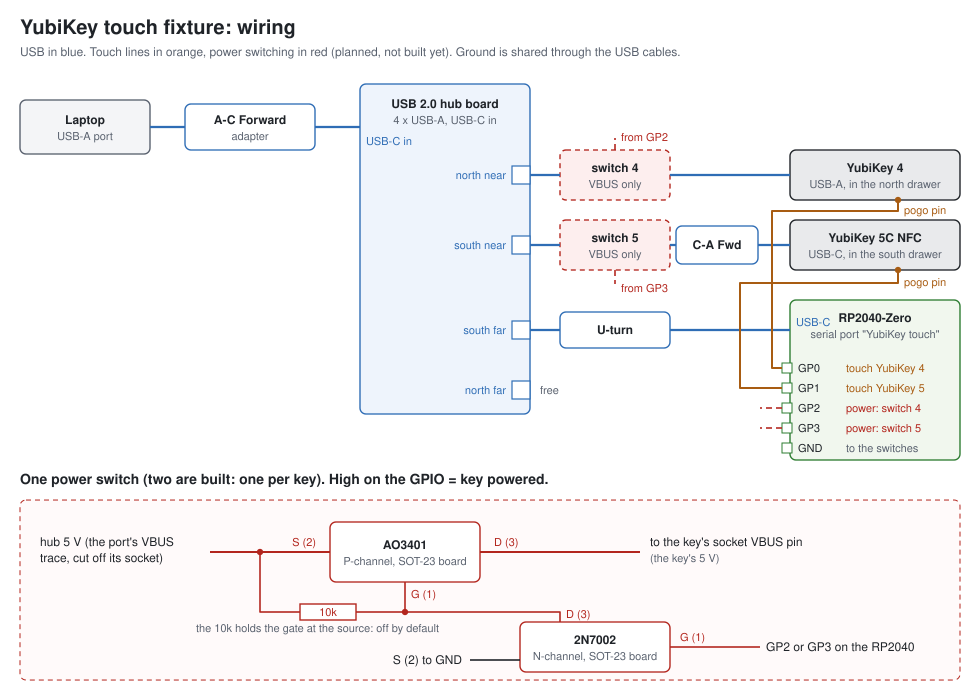

# YubiKey touch fixture

A small printed box that lets a computer touch two YubiKeys. A pogo pin rests on each key's touch disk,
and an RP2040-Zero grounds it on command, which the key reads as a finger. That lets the YubiKey
operations that wait for a touch run in tests with nobody at the desk: a PIV key with a touch policy
(see [Enable Touch Policy](../../docs/yubikey.md#enable-touch-policy)), FIDO, and OTP. It holds a
YubiKey 4 (USB-A) and a YubiKey 5C NFC (USB-C), and can also switch each key's power, so a test can
unplug and replug a key without anyone touching it.

> **Test keys only.** The touch is how a YubiKey knows a person is present. This fixture fakes it, so
> never put a key that protects anything real in it.


The animation is also in full size as [yubikey-touch-fixture.mp4](yubikey-touch-fixture.mp4).

## Status (rev H, November 2026)

| Part | State |
|---|---|
| Touch | **Works.** With the YubiKey 4 in the rev G test piece and its pin wired to GP0, `yktouch touch 4 500` was accepted 6 times out of 6: a FIDO registration that waits for a touch went through about 0.4 s after the touch began, and nothing registered in the 3 s before each touch. A finger on the bare wire works too. |
| Printed parts | Rev G was printed and assembled. Rev H fixes what that showed (a tight fit for the hub, nothing holding the YubiKey 5 adapter up) and is being printed. |
| YubiKey 5 touch | Same design as the YubiKey 4 side; its pin is not wired yet. |
| Power switching | Designed (see [Wiring](#wiring)), not built or tested yet. |

## How it works

- **Touch.** A pogo pin is held on each key's touch disk and wired to a GPIO of the RP2040-Zero. To touch,
  the GPIO goes low and grounds the disk; to let go, it becomes a floating input. It is never driven high.
- **Pin lift.** A pin resting on the disk would jam the key on its way in or out, so a slide bar lifts the
  pin 2.5 mm first. See [Pin lift](#pin-lift).
- **Power.** Each key's 5 V goes through a switch (an AO3401 driven by a 2N7002) that the RP2040 opens and
  closes. A key calibrates its touch sensor when it powers up, so the touch is always released first.
- **Host side.** The RP2040 shows up as a serial port named "YubiKey touch"; the `yktouch` script sends it
  commands such as `touch 4 500`. See [Firmware](#firmware).

## Wiring



Everything hangs off one 4-port USB 2.0 hub board. The RP2040-Zero plugs into one of its ports through
the U-turn adapter, so it shares the keys' ground and needs no ground wire for the touch. Its GP0 and
GP1 go straight to the two pogo pins.

For power switching, the hub's 5 V trace to each key's socket has to be cut, and an AO3401 put across
the cut: source on the hub side, drain on the socket side, with 10k from gate to source so it stays off on
its own. A 2N7002 pulls the gate to ground when the RP2040 drives GP2 or GP3 high. Each transistor sits
on a small SOT-23 board whose pads are numbered 1 (gate), 2 (source) and 3 (drain). This part is not
built yet.

## Parts

Prices as paid on AliExpress in October and November 2026, converted to US dollars at 3.21 ILS per USD
(the rate on 14 November 2026) and rounded. Most parts come in packs, so a second fixture costs little more. Listings change and disappear; the description says what to look for.

| Part | For | Used | Bought | USD |
|---|---|---|---|---|
| [RP2040-Zero](https://www.aliexpress.com/item/1005010768723373.html) (Waveshare layout) | Runs the firmware | 1 | 4 | 6.15 |
| [USB 2.0 hub board, 4 x USB-A, USB-C in](https://www.aliexpress.com/item/1005009184792924.html) | Everything plugs into it | 1 | 1 | 2.24 |
| [Pogo pins P75-D2](https://www.aliexpress.com/item/1005010463299946.html) | Rest on the touch disks | 2 | 100 | 7.97 |
| [USB adapters, Xinrongbao](https://www.aliexpress.com/item/1005006733624983.html), one listing, three versions | "A-C U Forward" (U-turn): hub to the RP2040; plugged into the hub it bends up over the board ("A-C U Reverse" bends down, into the board). "C-A Forward": YubiKey 5 to the hub. "A-C Forward": the laptop's USB-A port to the hub's USB-C input | 3 | 3 | 7.48 |
| [AO3401A P-channel MOSFET, SOT-23](https://www.aliexpress.com/item/4001278105988.html) | Power switches | 2 | 100 | 1.80 |
| [2N7002 N-channel MOSFET, SOT-23](https://www.aliexpress.com/item/1005006127106855.html) | Drive the AO3401 gates | 2 | 100 | 1.62 |
| [SOT-23 to SIP3 boards](https://www.aliexpress.com/item/1005006626188055.html) | Carry the transistors; 7.5 x 10 x 1.4 mm | 4 | 20 | 1.62 |
| [Resistor kit, 1/4 W, 30 values](https://www.aliexpress.com/item/1005006186890215.html) | 10k gate resistors | 2 | 600 | 2.43 |
| [Wire, 30 AWG, UL1423 PTFE, silver-plated](https://www.aliexpress.com/item/1005005321856209.html) | Touch and power wiring | about 1 m | 3 x 5 m | 4.94 |
| [Heat-shrink tube set](https://www.aliexpress.com/item/1005012934091641.html) | Insulating joints | | 8 m | 2.52 |
| [M2 brass heat-set inserts, 3 mm long](https://www.aliexpress.com/item/1005008897571758.html) | Lid screws | 2 | 100 | 2.86 |
| [M2 x 6 socket head screws](https://www.aliexpress.com/item/1005004531602992.html) | Lid | 2 | 50 | 1.25 |
| PLA, 1.75 mm | The printed parts (43 g) and two 7.5 mm pieces as cross pins | | | |
| [NNBILI USB-C male to male adapter](https://www.aliexpress.com/item/1005012016929409.html) | Optional: for a laptop with only USB-C ports, instead of "A-C Forward" | 0 or 1 | 1 | 1.55 |
| YubiKey 4, YubiKey 5C NFC | Test keys | 2 | | |

The parts above came to about $43. Tools used for this build:

| Tool | For | USD |
|---|---|---|
| [Pinecil V2](https://www.aliexpress.com/item/1005012505708387.html) soldering iron | Soldering | 53.67 |
| [Heat-set insert tips for the Pinecil (TS100 fit)](https://www.aliexpress.com/item/1005012157318263.html) | Pressing in the inserts | 7.28 |
| [Solder, 0.6 mm rosin core](https://www.aliexpress.com/item/1005006280566767.html), [flux NC-559](https://www.aliexpress.com/item/1005011861136037.html), [desoldering wick](https://www.aliexpress.com/item/1005007514789306.html) | Soldering | 9.18 |
| [Wire stripper, Pro'sKit 8PK-3001D](https://www.aliexpress.com/item/1005007370026286.html) | 30 AWG wire | 13.82 |
| [Digital calipers, 150 mm](https://www.aliexpress.com/item/1005011855690153.html) | Measuring the parts | 3.83 |
| [Anti-static tweezers](https://www.aliexpress.com/item/1005013152490978.html) | Small parts, pulling the wire through the tower | 2.61 |
| [7 inch digital microscope](https://www.aliexpress.com/item/1005009301431172.html), [helping hands](https://www.aliexpress.com/item/4001365281239.html), [iron stand](https://www.aliexpress.com/item/1005002842145055.html) | SOT-23 soldering | 56.37 |
| [Hand drill (pin vise), 0.2 to 3.4 mm](https://www.aliexpress.com/item/1005007092447606.html) | Clearing small holes | 3.18 |
| [Hex keys](https://www.aliexpress.com/item/1005002688809650.html) | The M2 screws | 3.48 |
| 3D printer (Prusa MK3S, smooth PEI sheet) | The printed parts | |

## Files

`fixture.scad` is the source. The `stl/` files are rendered from it, already turned the right way up for printing:

| File | What | Print |
|---|---|---|
| `stl/yubikey-touch-test.stl` | North end: wall, hub seat, YubiKey 4 drawer and tower | First: put the hub in, plug the YubiKey 4 in and check the pin lands on the button. Print one knob and one bar with it |
| `stl/yubikey-touch-body.stl` | Box, hub seat, both drawers, towers, insert blocks | Floor on the bed |
| `stl/yubikey-touch-deck.stl` | Board tray above the hub | Flat |
| `stl/yubikey-touch-lid.stl` | Lid with hold-down ribs | Top face on the bed |
| `stl/yubikey-touch-knob.stl` | Square knob that holds the pogo pin | Standing up, one per pin. Use a brim: it is tall and thin |
| `stl/yubikey-touch-bar.stl` | Slide bar that lifts the knob | Flat, one per pin. No glue on a smooth PEI sheet: let it cool and flex the sheet |

| Other files | What |
|---|---|
| `layout.svg`, `wiring.svg` | The drawings above, made by `drawings/make.sh` (see [Render](#render)) |
| `yubikey-touch-fixture.mp4`, `.gif` | The assembly animation, made by `drawings/animate.sh` |
| `firmware/` | The RP2040-Zero program |
| `yktouch` | Host script that sends commands to the RP2040 |
| `70-yktouch.rules` | udev rule so your user can open the serial port |

## Print settings (Prusa, PLA)

- 0.4 mm nozzle, 0.2 mm layers (0.15 mm for the test piece and body, for cleaner small holes)
- No supports. The tunnel roofs and wall openings bridge, and the insert blocks and lid ledges have 45° undersides.
- 3 perimeters and 20 % infill
- PLA on the smooth PEI sheet needs no glue; glue stick makes small parts very hard to remove

## Pin lift

A pogo pin resting on the key jams it: the pin tip drops into the dip around the gold touch disk, and pulling
the key pushes sideways on the tip, so the spring never compresses. So the pin is lifted before a key goes in
or out:

- The pin is pressed into a square knob that slides straight up and down in a square hole in the tower. It
  can't turn, so the wire can't twist.
- A short piece of 1.75 mm filament crosses the knob just above the top of the pin and sticks out through a
  slot in the tower's west wall into a slanted slot in the slide bar.
- Push the bar **north** (away from the box for the YubiKey 4 drawer, toward it for the YubiKey 5): the knob rises
  `pin_lift` (2.5 mm) and the key slides freely. Push it **south**: the pin presses onto the disk with
  `pin_press` (1 mm) of spring travel. The slot is flat at both ends, so the bar stays where you leave it.
- The knob sticks out 1.5 mm above the tower when the pin is down and 4 mm when it is up, so you can see which.
- The touch wire is soldered to the pin on the bench, never in place (there is no room in the tower, and the
  iron would melt it). It leaves the knob through a side slot facing the box, runs down a slot in the tower's
  box-side wall that is open at the top, and goes through a channel in the sloped rib into the box.

## Rev H, from the printed rev G body

- The hub with its adapters was a hard push into the box: the inside was exactly as long as they are, and the
  fences were 0.15 mm from the board. Now the inside is 1 mm longer (`slack`) and 1 mm wider, and the fences
  are 0.5 mm from the board (`fit`). Each pin sits over the middle of its button with the hub in the middle
  of its 1 mm of travel. The end walls have 1 mm pockets around the key openings, so each key still plugs all
  the way in when the hub rests against the other wall.
- The YubiKey 5 adapter hung from its socket at no set height, so the key had to find it blind. A cradle at
  the south wall (`yk5_cradle`) now holds the adapter's USB-C end where the key, lying on its floor, plugs in
  straight.
- The deck pockets and lid ribs fit the switch boards as they came (7.5 × 10 × 1.4, rev G guessed 7 × 9).

## Layout (rev G and H, measured)

The hub, the adapters and the keys were measured with calipers. `fixture.scad` places everything from these
numbers:

| What | Measured | Used for |
|---|---|---|
| Hub board | 32.3 (along the USB-C edge) × 35.5, no mounting holes | Corner pads and fences (`hub_seat`) |
| A sockets | Stick out 2.85 past the board edge, top 3.6 above the board, near ones centred 9.2 from the USB-C edge | Hub position: the north socket faces touch the inside of the north wall |
| YubiKey 5 adapter | Its USB-C face is 63.0 from the north socket face | Inside of the south wall (plus `slack`); the adapter face bears on it |
| YubiKey 5 adapter body | 14.5 wide × 7.0 tall; in the rev G body, with the key flat, its top was 19.8 below the wall top | Cradle seat at 3.95 above the bed, 0.4 clear each side |
| Switch boards (AO3401, 2N7002) | 7.5 × 10.0, 1.4 thick, SOT-23 transistor 2.9 × 1.4 | Deck pockets, lid ribs (`brd`, `BOARDS`) |
| U-turn adapter | 25.1 tall, reaches 2.5 below its plug | Box height (lid 0.8 above it) |
| RP2040 | Board bottom 15.4 above the hub board, lined up with the hub's east edge | Deck posts and lid hold-downs |
| YubiKey 4 in the hub | Socket face to button start 12.8, button 10 across | `pin_ty_yk4` (button centre 17.8 out from the socket face) |
| YubiKey 5 in its adapter | Adapter face to button start 14.7 | `pin_ty_yk5` (19.7 out from the adapter face) |

Still estimated (marked MEASURE in `fixture.scad`):

- `yk4_plug_gap`: the gap under the YubiKey 4's plug when the key lies flat. It sets the hub height, so the key lies on its tunnel floor.
- `yk5_plug_gap`: the same for the YubiKey 5 in its adapter. It sets how much the south drawer is raised.
- `hub_t` (board thickness, 1.6 assumed) and `yk5_neck` (the hole in the south wall for the plug end of the YubiKey 5).
- `pad_z` and `pin_press`: if the pin doesn't press, or presses too hard, change `bar_v_low` and reprint only the bar (lower slot = harder press).

## Render

```bash
docker run --rm -u $(id -u):$(id -g) -v "$PWD":/w -w /w openscad/openscad:2021.01 \
  openscad -D 'part="body"' -o stl/yubikey-touch-body.stl fixture.scad
```

The parts are `body`, `deck`, `lid`, `knob`, `bar`, `test`, `assembly` (everything in place, for viewing only) and `test_assembly` (the test piece with its knob and bar; add `-D lift_up=true` to see the pin lifted).

After changing `fixture.scad`, regenerate the drawings, so their measurements follow:

```bash
drawings/make.sh      # layout.svg and wiring.svg (needs docker and python3)
drawings/animate.sh   # yubikey-touch-fixture.mp4 and .gif (also needs blender and ffmpeg; a few minutes)
```

## Firmware

`firmware/` is the RP2040-Zero program (C, pico-sdk). It shows up on USB as a serial port named
"YubiKey touch".

| RP2040 pin | Goes to |
|---|---|
| GP0 | YubiKey 4 pogo pin (touch) |
| GP1 | YubiKey 5 pogo pin (touch) |
| GP2 | YubiKey 4 power switch (2N7002 gate) |
| GP3 | YubiKey 5 power switch (2N7002 gate) |
| GND | Hub ground (shared with the keys) |

A touch drives the pin low, which grounds the pad like a finger. Released, the pin floats; it is never
driven high. Both keys power up at boot with the touch released, because a key calibrates its touch
sensor at power-up. The on-board LED is dim green when ready and blue while touching.

Build and install:

```bash
firmware/build.sh            # builds firmware/build/yktouch.uf2 in Docker
```

Hold BOOT while plugging the board in (or, once it runs this firmware, open its port at 1200 baud) and
copy `yktouch.uf2` onto the `RPI-RP2` drive. To let your user open the serial port without the
`dialout` group:

```bash
sudo cp 70-yktouch.rules /etc/udev/rules.d/ && sudo udevadm control --reload && sudo udevadm trigger
```

Commands (one line each, every reply starts with `ok` or `err`):

```bash
./yktouch touch 5            # touch the YubiKey 5 for 500 ms
./yktouch touch 4 1500       # touch the YubiKey 4 for 1.5 s
./yktouch hold 5             # touch until released
./yktouch release 5
./yktouch power 4 off        # also: power 4 on
./yktouch cycle 5 [ms]       # power off for ms (default 1000), then on
./yktouch status
```

## Assembly order

1. Press in the M2 heat-set inserts with the Pinecil insert tip at about 220 °C. The plastic melts into the knurls and holds them.
2. Plug both adapters (the YubiKey 5 adapter and the U-turn) into the hub, then lower the hub onto its corner pads between the fences, north sockets toward the north wall. The YubiKey 5 adapter's USB-C end drops into the cradle at the south wall.
3. Fit the deck, the switch boards and the RP2040-Zero, which slides onto the U-turn plug. Then wire the power, as in [Wiring](#wiring).
   Each switch board lies in its pocket with the transistor end toward the end wall and the three pads (2, 3, 1)
   toward the wire slots in the middle: the lid ribs press on the bare strip beyond the transistor. Solder the
   wires to the pads from the top and trim them flush underneath, so the board lies flat.
4. Fit each pin lift. Solder before the pin goes in: once it is in the tower you can't reach it.
   1. Slide the bar into the sleeve on the tower's west face, pushed south.
   2. Push the touch wire through its channel from the box until it comes out in the tower, then pull it up out of the top of the tower, a few centimetres (tweezers help).
   3. Hold the pin above the fixture and solder the wire to the **side** of the barrel, within 1 mm of its top end. Keep the top end itself clean: the filament presses on it.
   4. Drop the pin into the knob from the top, tip first, with the wire lying in the knob's side slot. The solder joint rests on the floor of the slot, which stops the pin from falling through.
   5. Lower the knob into the tower with its side slot facing the box. The wire slides down the open slot in the tower's box-side wall; pull the extra wire gently back into the box as you go.
   6. With the key in its drawer, press the knob down until its cross hole lines up with the bar slot. Cut 7.5 mm of 1.75 mm filament and push it through the sleeve window, the bar slot and the tower slot into the knob's cross hole, until it stops against the far wall.
5. Drop the lid in 1 mm south, slide it north so the tab enters the wall slot, and fit the two M2×6 screws.
